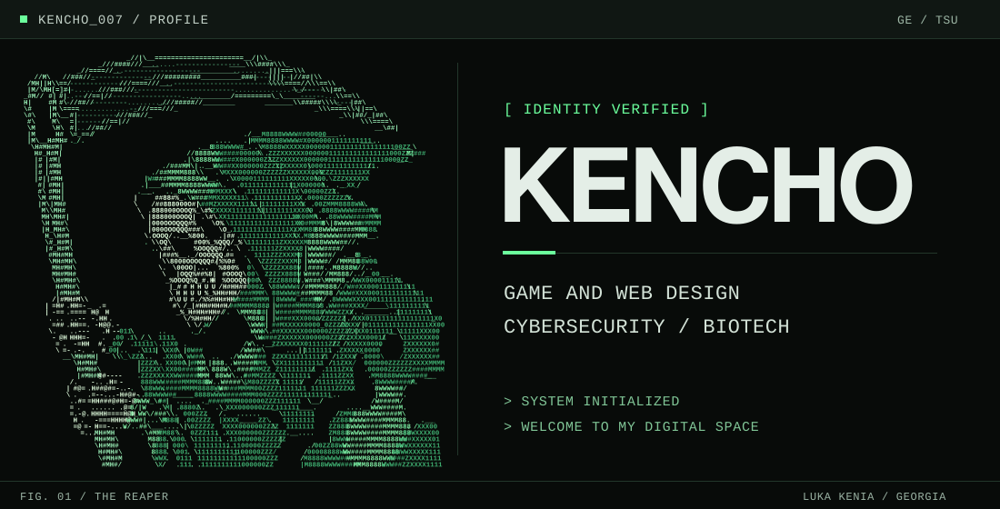

<picture>
  <source media="(max-width: 640px)" srcset="./assets/grim-reaper.svg">
  
</picture>

# Luka “Kencho” Kenia

**Game and web designer** based in Georgia. I study Applied Biosciences and Biotechnology at Tbilisi State University (TSU). I’m also taking the **Cyber Security Specialization** course at SCSA.

## SAN MARINO · GTA V Roleplay

**Co-founder** · Game design · Product direction · Team coordination

🎮 **Systems** · Jobs, progression, rewards and economy balancing  
🎨 **UI/UX** · Gameplay wireframes, interface design and playtesting

## Toolkit

**Hands-on** 
    

**Foundations** 
   

**Currently Learning** 
            

🛡️ **Fair play** · Soft Check / Cheat Hunter · I review suspicious gameplay.  
🧬 **Biology × code** · I’d like to build a DNA sequence viewer for students.

**Languages** · Georgian (native) · English (intermediate) · Russian (conversational) · German (basic)

[GitHub · @Kencho007](https://github.com/Kencho007) · [ASCII source](./assets/grim-reaper.txt)
